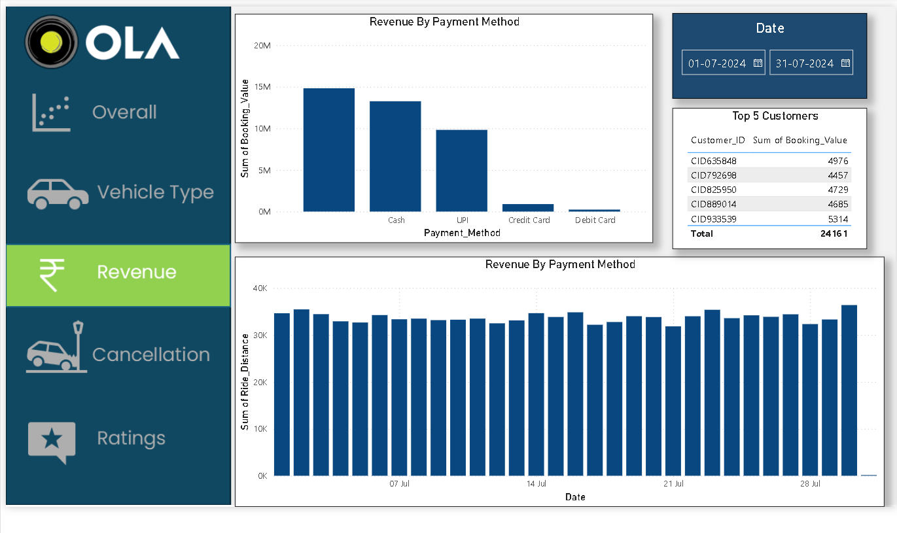
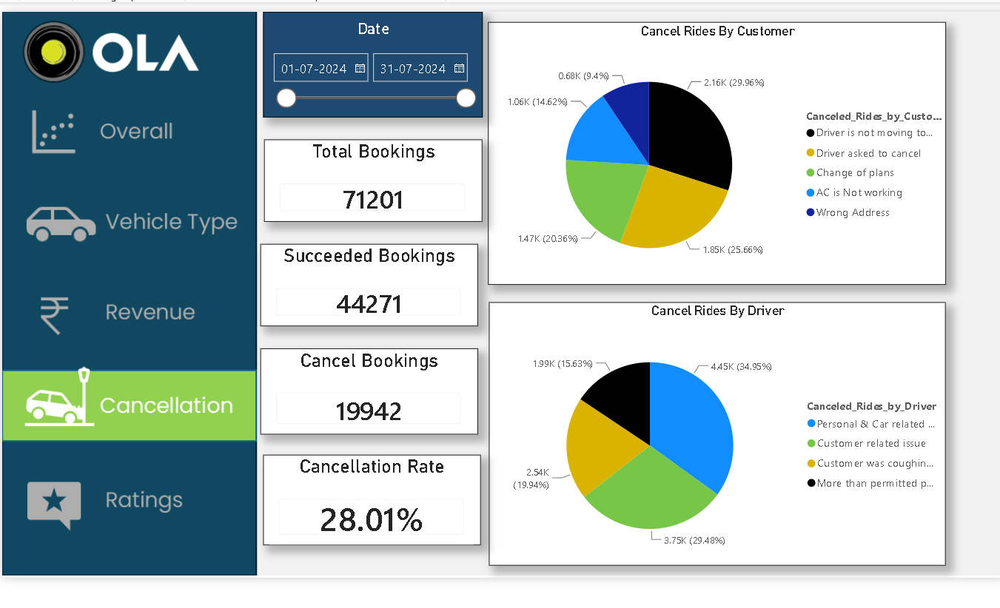
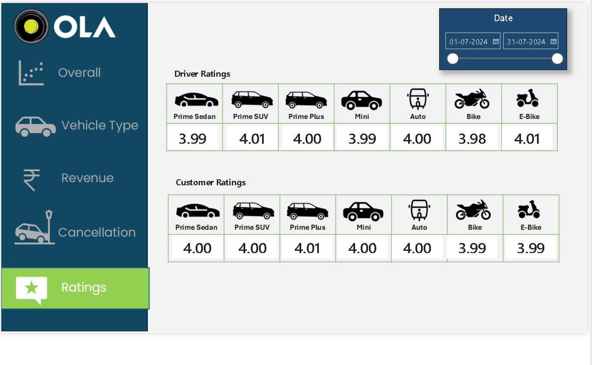

# Ola-booking-Analysis-
Ola ride booking data analysis using SQL and Power BI to explore booking trends, cancellations, ride distance, vehicle performance, and customer insights.
# Ola Ride Booking Analysis | SQL & Power BI

## Project Overview
An end-to-end data analytics project using SQL and Power BI to analyze Ola ride bookings, cancellations, revenue, vehicle performance, and customer ratings.

## Tools Used
- SQL Server / MySQL — update this to the database you actually used
- Microsoft Power BI
- SQL queries and views

## Project Files
- `Ola_Project.sql` — SQL analysis queries
- `Ola_Project.pbix` — Power BI dashboard
- PNG files — dashboard screenshots

## Dashboard Preview

### Overall Analysis

### Revenue Analysis

### Vehicle Type Analysis

### Cancellation Analysis

### Ratings Analysis

## How to Use
1. Download the SQL file to review the queries.
2. Open the Power BI file in Power BI Desktop.
3. Configure the data source if required.

## Key Insights
Add the main findings from your dashboard here.

## Author
Vanshika Saini
